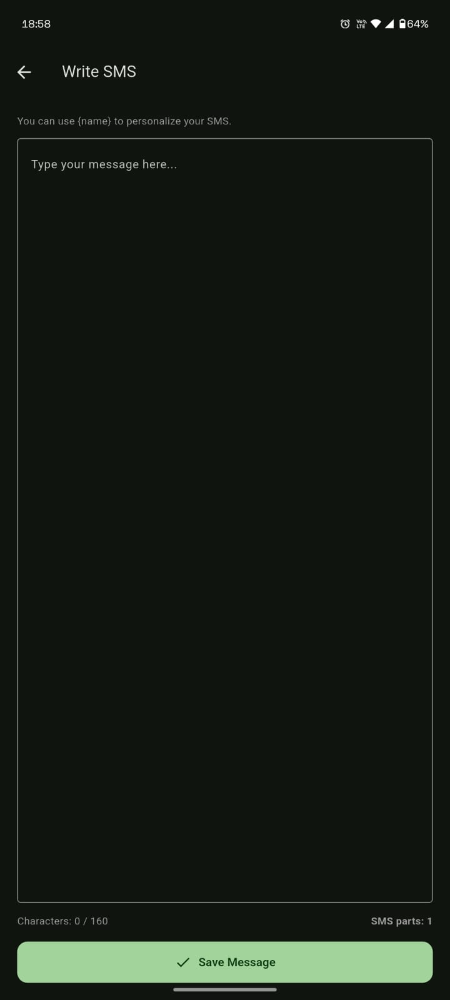
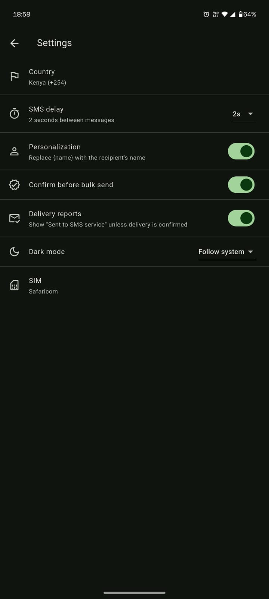
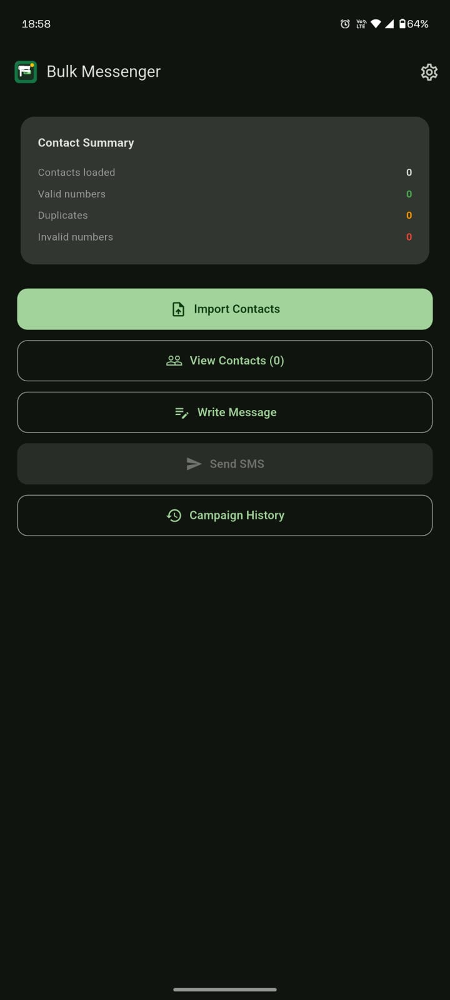

# Bulk SMS Sender

A Flutter Android app that imports contacts from an Excel/CSV file and
sends a personalized SMS to each one through the phone's own physical SIM
card, using `android.telephony.SmsManager` — no Twilio, Firebase,
WhatsApp, email, or online SMS gateway involved.

## What's in this project

```
lib/
  main.dart                  App entry point, theme, Provider setup
  app_state.dart             Central app state (contacts, message, settings, campaign)
  models/
    contact.dart              Imported contact + validation status
    sms_campaign.dart          A bulk-send run: recipients, progress, state
    sms_result.dart            Per-recipient send outcome
  services/
    excel_service.dart         .xlsx / .csv import, column detection, dedup
    phone_service.dart         Kenyan phone number validation/normalization
    sms_service.dart           Dart-side bridge to the native SmsManager
    storage_service.dart       Local persistence (shared_preferences)
    campaign_service.dart      The send queue: delay, pause/stop, resume, retry
  screens/
    home_screen.dart, contacts_screen.dart, message_screen.dart,
    send_screen.dart, progress_screen.dart, history_screen.dart,
    settings_screen.dart
  widgets/
    primary_button.dart, status_badge.dart, contact_list.dart, progress_card.dart

android/
  app/src/main/AndroidManifest.xml         SEND_SMS / READ_PHONE_STATE permissions
  app/src/main/kotlin/.../MainActivity.kt  Native SmsManager implementation
  app/build.gradle, build.gradle, settings.gradle, gradle.properties
```

## How SMS sending actually works

1. `lib/services/sms_service.dart` calls a `MethodChannel` named
   `bulk_sms_sender/sms`.
2. `android/.../MainActivity.kt` handles three methods:
   - `sendSms` — splits the message with `SmsManager.divideMessage()` if
     it's longer than one SMS, sends every part with
     `sendMultipartTextMessage()`, and waits for the real Android "sent"
     broadcast for **every** part before telling Flutter whether it
     succeeded.
   - `getSimSubscriptions` — lists active SIMs via `SubscriptionManager`
     for dual-SIM phones (used only if `READ_PHONE_STATE` was granted).
   - `hasSimCard` — checks `TelephonyManager.simState` before a send so
     the app can show "No SIM card was detected" instead of a confusing
     failure.
3. Nothing in this path makes a network call. The message leaves the
   device only through the cellular radio via the SIM that's physically
   in the phone.

"Sent" vs "Delivered": the app only ever reports **submission** to the
SMS service unless a delivery report genuinely comes back — see
`smsErrorMessage()` in `MainActivity.kt` and the "Delivery reports"
setting.

## Kenyan number normalization

`lib/services/phone_service.dart` turns `0712345678`, `254712345678`, and
`+254712345678` all into the canonical `+254712345678` form, and rejects
anything that isn't a plausible Kenyan mobile number (national numbers
starting with `7` or `1`, 9 digits long).

## The send queue

`lib/services/campaign_service.dart` sends **one message at a time**,
waits for the configured delay (default 3s, configurable to 2/3/5/10s in
Settings), and persists progress to local storage after every single
message. That's what makes pause/resume/stop and "resume after the app
was killed" work — on next launch, `HomeScreen` checks for a saved
in-progress campaign and asks before resuming (it never auto-resumes).

## Building the project

This deliverable contains the Flutter/Dart source and the Android
platform files that are project-specific (manifest, `MainActivity.kt`,
Gradle config). It does **not** include Flutter's generated Gradle
wrapper (`gradlew`, `gradle-wrapper.jar`) or default app icons, since
those are produced by the Flutter tool itself and aren't meaningful to
hand-write. Generate them once with the Flutter SDK installed:

```bash
# 1. Scaffold a throwaway project to get the Gradle wrapper + default icons
flutter create --platforms=android --org com.example bulk_sms_sender_scaffold

# 2. Copy this project's real source over the scaffold, keeping the
#    scaffold's android/gradle/ wrapper folder and res/mipmap icons
cp -r lib pubspec.yaml bulk_sms_sender_scaffold/
cp android/app/src/main/AndroidManifest.xml \
   bulk_sms_sender_scaffold/android/app/src/main/AndroidManifest.xml
cp android/app/src/debug/AndroidManifest.xml \
   bulk_sms_sender_scaffold/android/app/src/debug/AndroidManifest.xml
cp android/app/src/profile/AndroidManifest.xml \
   bulk_sms_sender_scaffold/android/app/src/profile/AndroidManifest.xml
cp -r android/app/src/main/kotlin/com/example/bulk_sms_sender \
   bulk_sms_sender_scaffold/android/app/src/main/kotlin/com/example/
cp android/app/build.gradle bulk_sms_sender_scaffold/android/app/build.gradle
cp android/build.gradle android/settings.gradle android/gradle.properties \
   bulk_sms_sender_scaffold/android/
cp android/app/src/main/res/values/styles.xml \
   bulk_sms_sender_scaffold/android/app/src/main/res/values/styles.xml
cp android/app/src/main/res/values-night/styles.xml \
   bulk_sms_sender_scaffold/android/app/src/main/res/values-night/styles.xml
cp android/app/src/main/res/drawable/launch_background.xml \
   bulk_sms_sender_scaffold/android/app/src/main/res/drawable/launch_background.xml

cd bulk_sms_sender_scaffold
flutter pub get
```

(If `flutter create` picks a different package name than
`com.example.bulk_sms_sender`, either pass `--org com.example` and app
name `bulk_sms_sender` as above so it matches exactly, or update the
`applicationId`/`namespace` in `android/app/build.gradle`, the
`package` line in `MainActivity.kt`, and the folder path under
`android/app/src/main/kotlin/` to match whatever it generated.)

### Run

```bash
flutter run            # with a physical Android phone connected via USB (recommended — emulators have no real SIM)
```

### Build a release APK

```bash
flutter build apk --release
```

Sign it properly for real distribution — the sample `build.gradle`
here uses the debug signing config only so development builds work out
of the box.

## Testing checklist (per the phased build plan)

1. Import the sample Excel/CSV below and confirm the contact summary
   counts (loaded/valid/duplicate/invalid) look right.
2. Write a message, confirm the character/parts counter updates live.
3. **Send a single test SMS to your own number first** — don't run a
   bulk campaign until this succeeds.
4. Run a small bulk campaign (a handful of your own numbers) and watch
   Pause/Resume/Stop.
5. Kill the app mid-campaign, reopen it, confirm the "Previous campaign
   found" dialog appears and Resume continues without resending anything
   already marked Sent.
6. Check History for the finished campaign and try "Retry Failed".

### Sample CSV

```csv
Name,Phone Number
John,0712345678
Mary,0723456789
Peter,0798765432
```

## Privacy

Everything — contacts, messages, campaign history — stays in local
storage on the device (`shared_preferences`). There is no backend, no
analytics, and no network call anywhere in the SMS-sending path.





